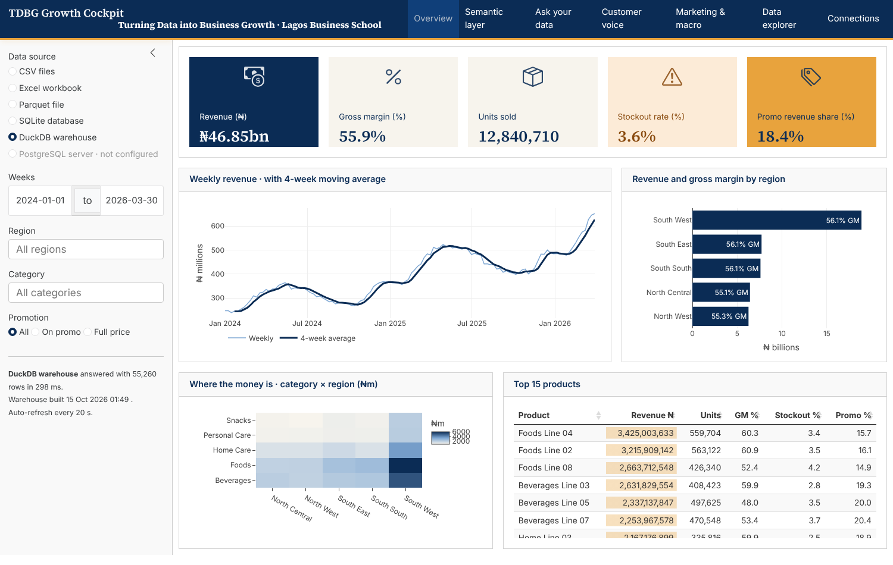
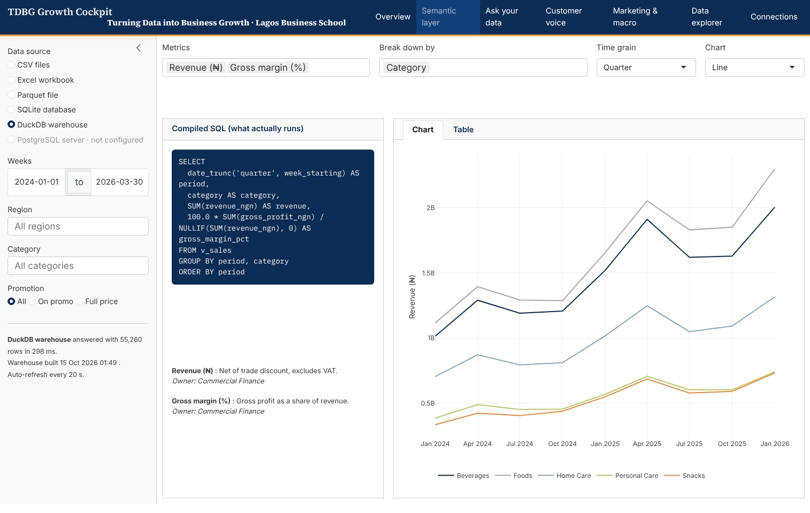
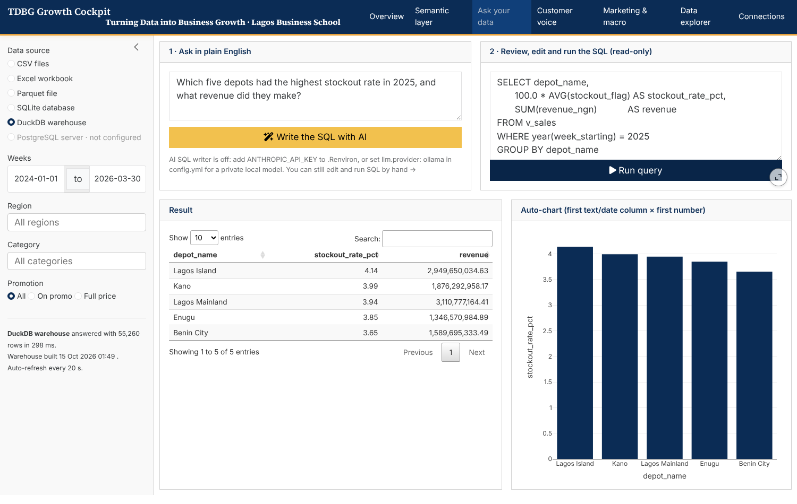
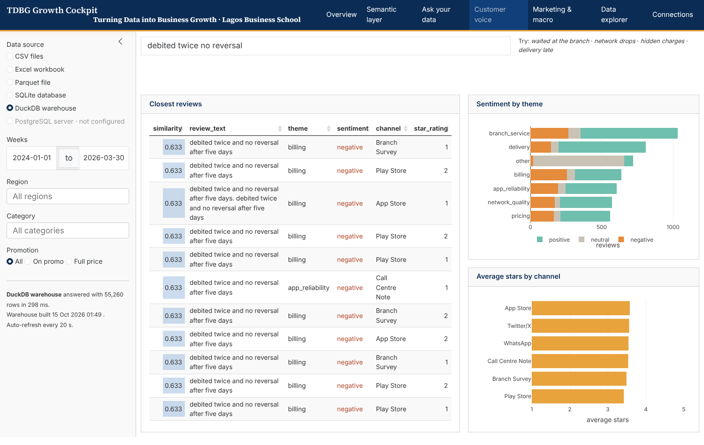
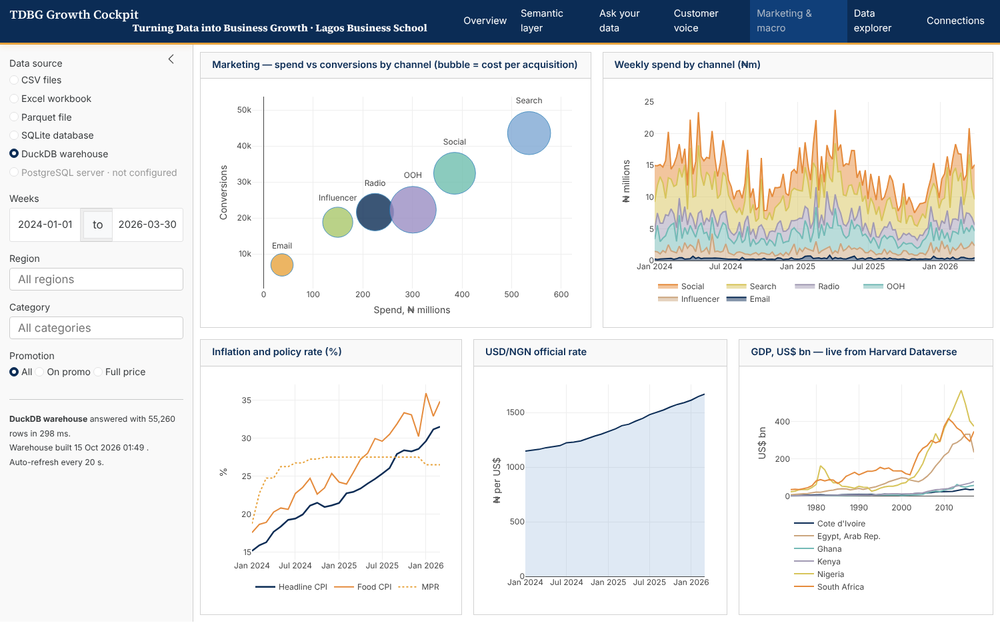
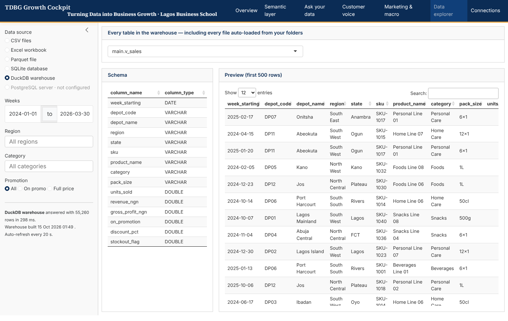
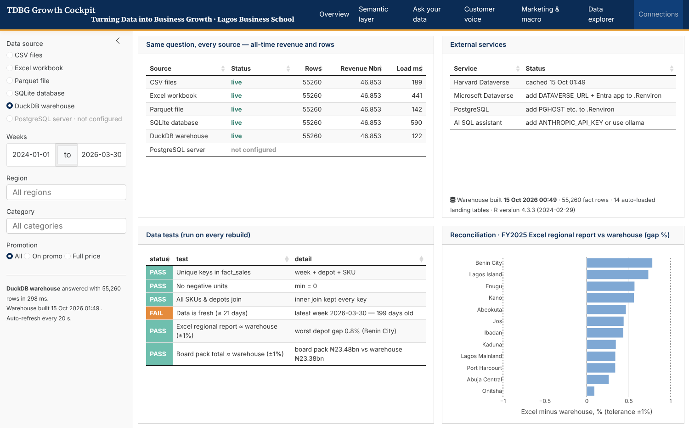
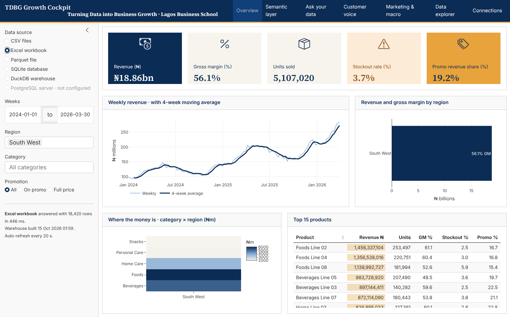

::: {.callout-note appearance="simple"}
## How to use this notebook in class

Every step has two parts:

1. **🧠 The prompt.** This is what you type into Claude, Positron Assistant or Copilot. Paste it as written. Then change it and see what breaks.
2. **The code.** This is the reviewed answer the prompt produced. Run it, read it line by line, and check it against the prompt. *You are the reviewer. The AI is the junior analyst.*

The notebook is **reproducible**. Delete the `data/db/` folder, click **Render**, and every database is rebuilt from the raw files in under a minute. Part 2 (`02-dashboard.qmd`) is the live Shiny dashboard that sits on top of what you build here.
:::

# The architecture we are building

{fig-alt="Six-layer architecture: sources, ingest, DuckDB warehouse (bronze, silver, gold), test gate, govern, serve, with an operations and security plane"}

How this notebook maps onto the diagram:

| Layer | Where in this notebook |
|---|---|
| **Sources → Ingest** | Steps 3–6 and 11–14: inventory, CSV, messy Excel, Parquet, Harvard Dataverse, World Bank / IMF / UN Comtrade / UNCTAD, Microsoft Dataverse, PostgreSQL |
| **Bronze** | Step 7: the `landing` schema. Every file is auto-loaded as received |
| **Silver / Gold** | Step 7: `clean_sales()` rules, then `fact_sales`, `dim_product`, `dim_depot` and the `v_sales` view |
| **Gate** | Step 14: data tests and reconciliation. Publishing happens only if they pass |
| **Govern** | Steps 9–10: the semantic layer (`metrics.yml`) and the vector index |
| **Serve** | Step 15: the SQLite serving mart, published *from* gold *after* the gate; Postgres and Dataverse; the Shiny dashboard (Part 2) |
| **Ops & security plane** | `config.yml` / `.Renviron`, `refresh.R`, atomic swaps, build log |

The **master tutorial** (`mastery/`) teaches every layer in depth, with exercises and nine sector playbooks.

The **same question** ("What was revenue by region last quarter?") can be answered from **six different sources**. The dashboard lets you switch between them live. When two sources disagree, that is a governance finding, not a bug in the dashboard.

# Set up the project

::: {.callout-tip icon=false}
## 🧠 Prompt 1 — packages
> I'm building a reproducible Quarto + Shiny analytics project in R. Write one R chunk that checks for each package I need and installs only the missing ones. I need: DuckDB and SQLite through DBI, dplyr/dbplyr, readr, readxl, writexl, yaml, config, Shiny with bslib and bsicons, plotly, DT, httr2, the `dataverse` package for Harvard Dataverse, and RPostgres. Then load the core ones and print the DuckDB version.
:::

```{r}
#| label: packages
pkgs <- c("DBI", "duckdb", "RSQLite", "dplyr", "dbplyr", "tidyr", "readr", "readxl",
          "writexl", "yaml", "config", "shiny", "bslib", "bsicons", "plotly", "DT",
          "httr2", "jsonlite", "dataverse", "RPostgres", "ggplot2", "knitr")
missing <- pkgs[!vapply(pkgs, requireNamespace, logical(1), quietly = TRUE)]
if (length(missing)) {
  # A non-interactive render process may not inherit RStudio's configured
  # mirror, so fall back to a public CRAN mirror only if none is set.
  if (is.null(getOption("repos")) || identical(getOption("repos")[["CRAN"]], "@CRAN@")) {
    options(repos = c(CRAN = "https://cloud.r-project.org"))
  }
  install.packages(missing)
}

library(tidyr)
library(ggplot2)
source("R/helpers.R")        # shared with the dashboard: config, connections, semantic layer
theme_set(theme_minimal(base_size = 12))
tdbg <- c("#9B8EC4", "#7FA8D4", "#6FBFAE", "#A9C86B", "#F2C14E", "#E58B3C")

cat("DuckDB", dbGetQuery(dbConnect(duckdb()), "select version()")[[1]],
    "| R", R.version$major, ".", R.version$minor, sep = " ")
```

::: {.callout-tip icon=false}
## 🧠 Prompt 2 — configuration and secrets
> Explain, for business students, why database paths belong in a `config.yml` and passwords belong in `.Renviron`, never in the code. Then show me the config my project is using as a readable table.
:::

```{r}
#| label: config
tibble::tibble(setting = names(cfg),
               value   = vapply(cfg, function(v) paste(unlist(v), collapse = " · "), "")) |>
  knitr::kable()
```

The project folder looks like this:

```
Shiny-Dashboard-Lab/
├── 01-build-data-layer.qmd   ← this notebook (builds everything)
├── 02-dashboard.qmd          ← the Quarto + Shiny dashboard
├── config.yml                ← where every source lives
├── .Renviron.example         ← template for secrets (copy to .Renviron)
├── refresh.R                 ← automation: rebuild + schedule
├── R/helpers.R               ← shared functions
├── semantic/metrics.yml      ← business definitions (the semantic layer)
└── data/
    ├── raw/        ← CSV, Excel, Parquet exactly as received
    ├── excel/      ← the Excel workbook we generate as a source
    ├── db/         ← tdbg.sqlite and tdbg.duckdb (generated)
    └── dataverse/  ← Harvard cache + files ready to import into Microsoft Dataverse
```

# Inventory every data file you have

::: {.callout-tip icon=false}
## 🧠 Prompt 3 — find the data
> Scan every folder listed under `data_roots` in my config.yml (skip any that don't exist on this machine). List every CSV, TSV, Excel, Parquet and JSON file with its folder, size in KB and last-modified date. Flag files bigger than `max_file_mb` and files that are exact duplicates of another file (same MD5 hash), because I copy folders a lot.
:::

```{r}
#| label: inventory
data_exts <- "\\.(csv|tsv|xlsx|xls|parquet|json)$"
roots <- vapply(cfg$data_roots, proj_path, "")
roots <- roots[dir.exists(roots)]

inventory <- lapply(roots, function(r) {
  f <- list.files(r, pattern = data_exts, recursive = TRUE, full.names = TRUE, ignore.case = TRUE)
  f <- f[!grepl("(^|/)(\\.|_|renv/|outputs/)", sub(r, "", f, fixed = TRUE))]   # skip hidden/system folders
  if (!length(f)) return(NULL)
  tibble::tibble(root = basename(r), file = sub(paste0(r, "/"), "", f, fixed = TRUE),
                 path = f, kb = round(file.size(f) / 1024, 1),
                 modified = as.Date(file.mtime(f)), md5 = unname(tools::md5sum(f)))
}) |> bind_rows() |>
  mutate(duplicate_of_earlier = duplicated(md5),
         too_big = kb > cfg$max_file_mb * 1024)

inventory |> select(root, file, kb, modified, duplicate_of_earlier, too_big) |>
  DT::datatable(options = list(pageLength = 8, scrollX = TRUE), rownames = FALSE)
```

On this machine the scan found **`r nrow(inventory)` files** in **`r length(roots)` folder(s)**. **`r sum(inventory$duplicate_of_earlier)`** of them are exact duplicates and will be skipped.

# Read the CSVs and test the data

The FMCG data is a small **star schema**. One fact table (`fmcg_sell_out`: one row per week × depot × SKU) points at two dimension tables (`fmcg_products`, `fmcg_depots`).

::: {.callout-tip icon=false}
## 🧠 Prompt 4 — profile before you trust
> Read fmcg_sell_out.csv, fmcg_products.csv and fmcg_depots.csv with readr. Before any analysis, run these data-quality checks and show the results as one table: row counts, date range, missing values per column, exact duplicate rows, duplicate business keys (week + depot + SKU), duplicate keys inside each dimension table, fact rows whose SKU or depot has no match in the dimension tables, and negative units. Tell me in one sentence what each failure would do to a revenue total.
:::

```{r}
#| label: read-csv
sell_out <- read_csv("data/raw/fmcg_sell_out.csv", show_col_types = FALSE)
products <- read_csv("data/raw/fmcg_products.csv", show_col_types = FALSE)
depots   <- read_csv("data/raw/fmcg_depots.csv",   show_col_types = FALSE)

dq <- tibble::tribble(
  ~check,                                   ~value,
  "Fact rows",                              nrow(sell_out),
  "Weeks covered",                          n_distinct(sell_out$week_starting),
  "Rows with blank units (stockouts)",      sum(is.na(sell_out$units_sold)),
  "Exact duplicate rows",                   sum(duplicated(sell_out)),
  "Duplicate keys (week+depot+SKU)",        sum(duplicated(sell_out[c("week_starting", "depot_code", "sku")])),
  "Duplicate SKU codes in products",        sum(duplicated(products$sku)),
  "Duplicate depot codes in depots",        sum(duplicated(depots$depot_code)),
  "SKUs missing from products table",       length(setdiff(sell_out$sku, products$sku)),
  "Depots missing from depots table",       length(setdiff(sell_out$depot_code, depots$depot_code)),
  "Negative units",                         sum(sell_out$units_sold < 0, na.rm = TRUE)
)
knitr::kable(dq, format.args = list(big.mark = ","))
```

::: {.callout-warning}
## What the checks found, and the rules we wrote
- **Blank units.** The board pack's *Notes* sheet says *"A stockout week is recorded as blank, not zero."* Rule: blank becomes 0 and the stockout flag stays at 1.
- **Duplicates.** About 200 rows are exact copies, almost certainly from a double-loaded extract. If we left them in, revenue would be overstated. Rule: drop exact duplicates, then keep the first row for each key.

- **A depot appears twice.** `DP04` is listed as *Abuja Central* and again as *Abuja Central (Wuse II)*: a rename that someone appended instead of updating. Joining on it would **double-count every Abuja sale**. Rule: one row per key, keep the first (original) one.

These rules live in **one function**, `clean_sales()` in `R/helpers.R`. The CSV, Excel, SQLite and DuckDB paths all use the same rule. The Parquet file was cleaned by someone else at an earlier date, so it does *not* go through this function. Watch for that on the dashboard's Connections page.
:::

```{r}
#| label: clean
depots   |> filter(depot_code %in% depot_code[duplicated(depot_code)])   # the offending rows
sales    <- clean_sales(sell_out, products, depots)
products <- distinct(products, sku, .keep_all = TRUE)                  # clean dims for the databases
depots   <- distinct(depots, depot_code, .keep_all = TRUE)
glimpse(sales)
```

# Read messy Excel, the way it really arrives

::: {.callout-tip icon=false}
## 🧠 Prompt 5 — tame the board pack
> `board_pack.xlsx` has three sheets. "Sales" has a title, a source line and a blank row before the real header. "Depots" is clean. "Notes" holds metric definitions. Read each one correctly with readxl, show me the first rows, and keep the Notes sheet as metadata because it contains our business rules.
:::

```{r}
#| label: excel-boardpack
excel_sheets("data/raw/board_pack.xlsx")
bp_sales <- read_excel("data/raw/board_pack.xlsx", sheet = "Sales", skip = 3) |>
  mutate(across(c(units, revenue_ngn), as.numeric))
bp_notes <- read_excel("data/raw/board_pack.xlsx", sheet = "Notes")
head(bp_sales, 4)
bp_notes
```

::: {.callout-tip icon=false}
## 🧠 Prompt 6 — un-pivot a presentation spreadsheet
> `regional_report.xlsx` is built for printing, not analysis. It has four title rows, the region is typed only once per block (merged cells), there is one column per month, and the numbers are text like "₦149,023,348". Turn it into a tidy long table: region, depot, month (a real date in FY2025), revenue_ngn (a number). Use tidyr::fill and pivot_longer, and readr::parse_number.
:::

```{r}
#| label: excel-regional
regional <- read_excel("data/raw/regional_report.xlsx", skip = 4) |>
  filter(!is.na(depot)) |>
  fill(region, .direction = "down") |>                     # undo the merged cells
  pivot_longer(Jan:Dec, names_to = "mon", values_to = "revenue_txt") |>
  mutate(month = as.Date(paste("2025", mon, "01"), "%Y %b %d"),
         revenue_ngn = parse_number(revenue_txt)) |>       # "₦149,023,348" -> 149023348
  select(region, depot, month, revenue_ngn)
head(regional)
```

# Read Parquet without importing it

::: {.callout-tip icon=false}
## 🧠 Prompt 7 — query a file like a table
> Show me how DuckDB can run SQL directly on `fmcg_weekly.parquet` without loading it into R first. Count the rows, get the date range, and total revenue by year. Explain in two sentences why Parquet is faster and smaller than CSV.
:::

```{r}
#| label: parquet
con_mem <- dbConnect(duckdb())
dbGetQuery(con_mem, "
  SELECT year, COUNT(*) AS rows, MIN(week_starting) AS first_week,
         round(SUM(revenue_ngn) / 1e9, 2) AS revenue_bn
  FROM read_parquet('data/raw/fmcg_weekly.parquet')
  GROUP BY year ORDER BY year")
dbDisconnect(con_mem, shutdown = TRUE)
```

The Parquet file is **`r round(file.size("data/raw/fmcg_weekly.parquet")/1e6,1)` MB**. The CSV holding the same rows is **`r round(file.size("data/raw/fmcg_sell_out.csv")/1e6,1)` MB**, and it has no product or depot columns.

# Build the warehouse: DuckDB (bronze → silver → gold)

DuckDB is "SQLite for analytics". It runs inside R with no server and is very fast on aggregations. We use it as the **warehouse**: every file lands here, the clean model lives here, and so do the semantic layer and the vector index.

::: {.callout-tip icon=false}
## 🧠 Prompt 8 — auto-load every file (the landing zone)
> Open a new DuckDB file and create a schema called `landing`. Loop over my inventory and load every non-duplicate file into its own table. Use DuckDB's `read_csv_auto` for CSV/TSV, `read_parquet` for Parquet and `read_json_auto` for JSON. For Excel, load each sheet as its own table with readxl. Give each table a clean snake_case name prefixed by its folder, and record every load (table, source file, rows, columns, time) in a `landing_catalog` table. If one file fails, log the error and carry on.
:::

```{r}
#| label: duckdb-landing
atomic_swap <- function(tmp, final) {        # build to a temp file, then replace in one step (macOS, Linux, Windows)
  if (file.exists(final)) file.remove(final)
  file.rename(tmp, final)
}
dir.create("data/db", showWarnings = FALSE, recursive = TRUE)
duck_tmp <- paste0(proj_path(cfg$duckdb_path), ".building")
unlink(c(duck_tmp, paste0(duck_tmp, ".wal")))
dk <- dbConnect(duckdb(), dbdir = duck_tmp)
invisible(dbExecute(dk, "CREATE SCHEMA landing"))

snake <- function(x) gsub("^_|_$", "", gsub("[^a-z0-9]+", "_", tolower(x)))
q <- function(p) paste0("'", gsub("'", "''", normalizePath(p)), "'")
catalog <- list(); used <- character()

for (i in which(!inventory$duplicate_of_earlier & !inventory$too_big)) {
  f <- inventory[i, ]; ext <- tolower(tools::file_ext(f$path))
  base <- snake(paste(f$root, tools::file_path_sans_ext(basename(f$file))))
  if (base %in% used) base <- paste0(base, "_", i)            # same file name in two sub-folders
  used <- c(used, base)
  res <- tryCatch({
    if (ext %in% c("csv", "tsv", "parquet", "json")) {
      reader <- switch(ext, csv = , tsv = "read_csv_auto(%s, sample_size = -1)",
                       parquet = "read_parquet(%s)", json = "read_json_auto(%s)")
      dbExecute(dk, sprintf("CREATE OR REPLACE TABLE landing.%s AS SELECT * FROM %s",
                            base, sprintf(reader, q(f$path))))
      tibble::tibble(table_name = base, source_file = f$file, sheet = NA_character_)
    } else {
      bind_rows(lapply(excel_sheets(f$path), function(s) {
        tn <- snake(paste(base, s))
        dbWriteTable(dk, DBI::Id(schema = "landing", table = tn),
                     suppressMessages(read_excel(f$path, sheet = s, .name_repair = "universal")), overwrite = TRUE)
        tibble::tibble(table_name = tn, source_file = f$file, sheet = s)
      }))
    }
  }, error = function(e) tibble::tibble(table_name = NA, source_file = f$file, sheet = conditionMessage(e)))
  catalog[[length(catalog) + 1]] <- mutate(res, root = f$root)
}
landing_catalog <- bind_rows(catalog) |> filter(!is.na(table_name)) |>
  rowwise() |>
  mutate(rows = dbGetQuery(dk, sprintf("SELECT COUNT(*) n FROM landing.%s", table_name))$n,
         cols = nrow(dbGetQuery(dk, sprintf("DESCRIBE landing.%s", table_name)))) |>
  ungroup() |> mutate(loaded_at = Sys.time())
dbWriteTable(dk, "landing_catalog", landing_catalog, overwrite = TRUE)
landing_catalog |> select(root, table_name, sheet, rows, cols) |>
  DT::datatable(options = list(pageLength = 8), rownames = FALSE)
```

::: {.callout-tip icon=false}
## 🧠 Prompt 9 — the clean model on top of the landing zone
> In the same DuckDB file, create the analysis-ready tables: `fact_sales` (from my cleaned R data frame), `dim_product`, `dim_depot`, `marketing_spend`, `ng_macro_monthly`, the two tidy Excel tables (`excel_board_pack_sales`, `excel_regional_monthly`), and a `v_sales` view over `fact_sales`. Use proper DATE types. Add a `build_log` table recording when the warehouse was built and how many rows each table holds.
:::

```{r}
#| label: duckdb-model
#| output: false
dbWriteTable(dk, "fact_sales",  sales, overwrite = TRUE)
dbWriteTable(dk, "dim_product", products, overwrite = TRUE)
dbWriteTable(dk, "dim_depot",   depots, overwrite = TRUE)
dbExecute(dk, "CREATE OR REPLACE TABLE marketing_spend AS
               SELECT * FROM read_csv_auto('data/raw/marketing_spend.csv')")
dbExecute(dk, "CREATE OR REPLACE TABLE ng_macro_monthly AS
               SELECT * FROM read_csv_auto('data/raw/ng_macro_monthly.csv')")
dbWriteTable(dk, "excel_board_pack_sales", bp_sales, overwrite = TRUE)
dbWriteTable(dk, "excel_regional_monthly", regional, overwrite = TRUE)
dbWriteTable(dk, "excel_board_pack_notes", bp_notes, overwrite = TRUE)
dbExecute(dk, "CREATE OR REPLACE VIEW v_sales AS SELECT * FROM fact_sales")
```

```{r}
#| label: duckdb-tables
dbGetQuery(dk, "SELECT table_name, estimated_size AS rows FROM duckdb_tables()
                WHERE schema_name = 'main' ORDER BY table_name")
```

# An Excel workbook as a source

Many teams' "database" is a shared workbook. We generate one so the dashboard can show Excel as a live source too.

::: {.callout-tip icon=false}
## 🧠 Prompt 10 — workbook as a data source
> Use writexl to save the raw sell-out data, products and depots as three sheets ("sales", "products", "depots") in data/excel/tdbg_sales_workbook.xlsx, plus a "README" sheet that explains each sheet and the cleaning rules. Keep the raw data raw: the dashboard applies the cleaning.
:::

```{r}
#| label: excel-source
dir.create("data/excel", showWarnings = FALSE)
writexl::write_xlsx(list(
  README = tibble::tibble(sheet = c("sales", "products", "depots"),
                          contents = c("Weekly sell-out by depot x SKU (raw: blanks = stockout, contains duplicates)",
                                       "SKU master with standard unit cost", "Depot master with region and state")),
  sales = sell_out, products = products, depots = depots), proj_path(cfg$excel_path))
file.info(proj_path(cfg$excel_path))[, c("size", "mtime")]
```

# The semantic layer: one definition of "revenue"

A **semantic layer** stores business definitions (metrics, dimensions, owners) separately from charts. Power BI, dbt, Looker and Cube all have one. Ours is a short YAML file, `semantic/metrics.yml`, that compiles to SQL.

::: {.callout-tip icon=false}
## 🧠 Prompt 11 — compile metrics to SQL
> Read semantic/metrics.yml. Show the metric catalogue as a table (name, label, SQL, description). Then use `compile_metric_sql()` to generate the SQL for "revenue, gross margin % and stockout rate by region, by quarter" and run it on DuckDB. Also save the catalogue into DuckDB as a `semantic_metrics` table, so any tool connected to the warehouse can discover the definitions.
:::

```{r}
#| label: semantic-layer
layer <- read_semantic()
semantic_metrics <- tibble::tibble(
  metric = names(layer$metrics),
  label  = vapply(layer$metrics, `[[`, "", "label"),
  sql    = vapply(layer$metrics, `[[`, "", "sql"),
  format = vapply(layer$metrics, `[[`, "", "format"),
  description = vapply(layer$metrics, `[[`, "", "description"),
  owner  = layer$owner)
dbWriteTable(dk, "semantic_metrics", semantic_metrics, overwrite = TRUE)
knitr::kable(semantic_metrics |> select(metric, label, sql))

demo_sql <- compile_metric_sql(layer, c("revenue", "gross_margin_pct", "stockout_rate_pct"),
                               dims = "region", grain = "quarter",
                               where = "week_starting >= DATE '2025-01-01'")
cat(demo_sql)
```

```{r}
#| label: semantic-run
#| fig-height: 4
dbGetQuery(dk, demo_sql) |>
  ggplot(aes(period, revenue / 1e9, colour = region)) +
  geom_line(linewidth = 1) + scale_colour_manual(values = tdbg) +
  labs(x = NULL, y = "Revenue (₦ bn)", colour = NULL,
       title = "Quarterly revenue by region — compiled from the semantic layer")
```

# A semantic (vector) search database for customer reviews

"Semantic database" can also mean **vector search**. Each text becomes a vector of numbers, and the database finds the texts *closest in meaning* to a query. We build a transparent offline version first (TF-IDF vectors stored as DuckDB arrays, searched with `list_cosine_similarity`). Then we show how to swap in a real embedding model.

::: {.callout-tip icon=false}
## 🧠 Prompt 12 — embed and index the reviews
> Join customer_reviews.csv to customer_reviews_labelled.csv on review_id. Build a TF-IDF vocabulary from the review text (lower-case, drop words of 2 letters or fewer). Store each review's normalised vector as a DOUBLE[] column in a DuckDB table `review_docs`, and the vocabulary with its IDF weights in `review_vocab`. Then write a search function that embeds a query the same way and ranks reviews by cosine similarity *inside DuckDB*. Test it with "charged twice and no refund".
:::

```{r}
#| label: vector-build
reviews <- read_csv("data/raw/customer_reviews.csv", show_col_types = FALSE) |>
  left_join(read_csv("data/raw/customer_reviews_labelled.csv", show_col_types = FALSE) |>
              select(review_id, theme, sentiment, intent, severity), by = "review_id")

toks  <- tokenize(reviews$review_text)
df    <- table(unlist(lapply(toks, unique)))                 # document frequency
vocab <- tibble::tibble(term = names(df), docs = as.integer(df)) |>
  mutate(idf = log(nrow(reviews) / docs) + 1, idx = row_number())
emb   <- embed_text(reviews$review_text, vocab)              # n_reviews x n_terms

review_docs <- reviews |> mutate(vec = lapply(seq_len(nrow(emb)), function(i) emb[i, ]))
dbWriteTable(dk, "review_vocab", vocab, overwrite = TRUE)
dbWriteTable(dk, "review_docs",  review_docs, overwrite = TRUE)
cat(nrow(review_docs), "reviews embedded into", nrow(vocab), "dimensions\n")
```

```{r}
#| label: vector-search
q_vec <- embed_text("charged twice and no refund", vocab)[1, ]
dbGetQuery(dk, sprintf("
  SELECT round(list_cosine_similarity(vec, %s::DOUBLE[]), 3) AS similarity,
         theme, sentiment, channel, review_text
  FROM review_docs ORDER BY similarity DESC LIMIT 6", vec_literal(q_vec)))
```

::: {.callout-tip icon=false}
## 🧠 Prompt 12b — upgrade to real embeddings (optional)
> Replace my TF-IDF `embed_text()` with real sentence embeddings from the Hugging Face Inference API (`sentence-transformers/all-MiniLM-L6-v2`, 384 dimensions), batching 64 texts per call and reading HF_TOKEN from .Renviron. Store them as FLOAT[384] in DuckDB and build an HNSW index with the `vss` extension so search stays fast at a million rows.
:::

```{r}
#| label: vector-hf
#| eval: !expr nzchar(Sys.getenv("HF_TOKEN"))
hf_embed <- function(texts) {
  httr2::request("https://router.huggingface.co/hf-inference/models/sentence-transformers/all-MiniLM-L6-v2/pipeline/feature-extraction") |>
    httr2::req_auth_bearer_token(Sys.getenv("HF_TOKEN")) |>
    httr2::req_body_json(list(inputs = texts)) |>
    httr2::req_perform() |> httr2::resp_body_json(simplifyVector = TRUE)
}
batches <- split(reviews$review_text, ceiling(seq_along(reviews$review_text) / 64))
hf_vecs <- do.call(rbind, lapply(batches, hf_embed))
dbExecute(dk, "INSTALL vss; LOAD vss;")
dbWriteTable(dk, "review_docs_hf", reviews |> select(review_id, review_text) |>
               mutate(vec = lapply(seq_len(nrow(hf_vecs)), function(i) hf_vecs[i, ])), overwrite = TRUE)
dbExecute(dk, "ALTER TABLE review_docs_hf ALTER vec TYPE FLOAT[384]")
dbExecute(dk, "SET hnsw_enable_experimental_persistence = true")
dbExecute(dk, "CREATE INDEX hnsw_reviews ON review_docs_hf USING HNSW (vec) WITH (metric = 'cosine')")
```

# Pull research data from Harvard Dataverse

[Harvard Dataverse](https://dataverse.harvard.edu) is an open repository with thousands of research datasets, each with a DOI. The `dataverse` R package reads a file straight from its DOI.

::: {.callout-tip icon=false}
## 🧠 Prompt 13 — data from a DOI
> Using the `dataverse` R package, download gdp.tab from Harvard Dataverse dataset doi:10.7910/DVN/8M7FUY (World Bank GDP, current US$). Keep Nigeria, Ghana, Kenya, South Africa, Egypt and Côte d'Ivoire, turn ".." into missing values, convert GDP to US$ billions, and save a local CSV cache so the dashboard still works offline. If the download fails, fall back to the cache. Load the result into DuckDB as `dv_gdp`.
:::

```{r}
#| label: harvard-dataverse
cache <- "data/dataverse/harvard_gdp.csv"
dir.create("data/dataverse", showWarnings = FALSE)
hv <- cfg$harvard_dataverse
dv_gdp <- tryCatch({
  raw <- dataverse::get_dataframe_by_name(hv$file, dataset = hv$dataset, server = hv$server,
                                          .f = function(x) readr::read_tsv(x, show_col_types = FALSE))
  out <- raw |>
    rename(year = 1, country = 3, iso3 = 4, gdp = 5) |>
    filter(iso3 %in% unlist(hv$countries)) |>
    mutate(year = as.integer(year), gdp_usd_bn = suppressWarnings(as.numeric(gdp)) / 1e9) |>
    select(year, country, iso3, gdp_usd_bn) |> filter(!is.na(gdp_usd_bn))
  write_csv(out, cache); out
}, error = function(e) { message("Dataverse unreachable, using cache: ", conditionMessage(e)); read_csv(cache, show_col_types = FALSE) })
dbWriteTable(dk, "dv_gdp", dv_gdp, overwrite = TRUE)

ggplot(dv_gdp, aes(year, gdp_usd_bn, colour = country)) + geom_line(linewidth = .9) +
  scale_colour_manual(values = tdbg) +
  labs(x = NULL, y = "GDP (US$ bn)", colour = NULL, title = "Pulled live from Harvard Dataverse")
```

# Official statistics: World Bank, IMF, UN Comtrade, UNCTAD

Most business questions in Nigeria need a macro frame: inflation, FX, growth, trade partners, remittances. The official providers publish this through free APIs. They go into the warehouse like any other source: pulled, cached for offline use, landed with their source named, and tested.

| Provider | What it gives you | Access |
|---|---|---|
| **World Bank WDI** | ~1,400 development indicators by country and year (growth, inflation, unemployment, remittances) | Free API, no key |
| **IMF WEO** (DataMapper) | Growth, inflation, debt, *including IMF projections* | Free API, no key |
| **UN Comtrade** | Goods trade by partner and product (HS codes) | Free preview API; a free key for bulk |
| **UNCTADstat** | FDI, trade in services, maritime, commodity prices | Free registration (client id and secret) |
| Also worth knowing | AfDB Data Portal, ILOSTAT, FAOSTAT, OECD, NBS, CBN statistical bulletin, DMO, sector regulators | Mostly CSV or API |

::: {.callout-tip icon=false}
## 🧠 Prompt 14b — official statistics as warehouse sources
> Using R/open_data.R, pull World Bank WDI (GDP growth, inflation, GDP per capita, unemployment, remittances as % of GDP), IMF WEO (real GDP growth, inflation and government debt, including projections) and UN Comtrade (Nigeria's 2023 exports by partner) for Nigeria and five African peers. Pull UNCTADstat only if credentials are set. Bind them into one tidy table with source, indicator, country, year and value, cache every pull for offline use, and load it into DuckDB as open_macro. Then chart Nigeria's inflation as reported by the World Bank vs the IMF, including the IMF's projections.
:::

```{r}
#| label: open-data
source("R/open_data.R")
open <- open_macro()
dbWriteTable(dk, "open_macro", open, overwrite = TRUE)
count(open, source, dataset, name = "rows")

infl <- open |> filter(iso3 == "NGA", indicator %in% c("FP.CPI.TOTL.ZG", "PCPIPCH"), year >= 2010) |>
  mutate(series = ifelse(source == "IMF", "IMF WEO (incl. projections)", "World Bank WDI"))
ggplot(infl, aes(year, value, colour = series)) + geom_line(linewidth = 1) +
  geom_vline(xintercept = as.numeric(format(Sys.Date(), "%Y")) - 0.5, linetype = 2, colour = "grey50") +
  scale_colour_manual(values = c("#E8A33D", "#0B2C55")) +
  labs(x = NULL, y = "Inflation, % y/y", colour = NULL, title = "Nigeria inflation: two official sources",
       subtitle = "Right of the dashed line is IMF projection, not data")
```

::: {.callout-note}
Two official sources rarely match exactly: different base years, revisions and release dates. Store both, label the source on every chart, and **never splice a projection onto actual data without marking it.** That is a semantic-layer rule (Chapter 10 of the master tutorial).
:::

# Microsoft Dataverse (Power Platform)

**Microsoft Dataverse** is the database behind Power Apps, Power Automate and Dynamics 365. It is often where operational data lives in Microsoft-first organisations. It needs an organisation and an app registration, so this section has two halves. You can always do the first half. The second half runs automatically once your credentials are in `.Renviron`.

::: {.callout-tip icon=false}
## 🧠 Prompt 14 — sample tables for Dataverse
> Create two CSV files ready to import into Microsoft Dataverse: a depots table, and a monthly sales summary by depot and category with revenue, units, gross profit and stockout weeks. Use simple column names with no spaces. Then give me numbered steps to create tables from them in make.powerapps.com, and to register an Entra ID app so R can read them through the Dataverse Web API.
:::

```{r}
#| label: msdv-sample
monthly_for_dv <- sales |>
  mutate(month = format(week_starting, "%Y-%m-01")) |>
  group_by(month, depot_code, depot_name, region, category) |>
  summarise(revenue_ngn = round(sum(revenue_ngn), 2), units = sum(units_sold),
            gross_profit_ngn = round(sum(gross_profit_ngn), 2),
            stockout_weeks = sum(stockout_flag), .groups = "drop") |>
  mutate(record_name = paste(month, depot_code, category, sep = " | "), .before = 1)
write_csv(depots, "data/dataverse/depots_for_dataverse.csv")
write_csv(monthly_for_dv, "data/dataverse/monthly_sales_for_dataverse.csv")
cat("Ready to import:", nrow(depots), "depots and", nrow(monthly_for_dv), "monthly rows\n")
```

::: {.callout-note collapse="true"}
## Step-by-step: putting the sample tables into Microsoft Dataverse (click to expand)
1. Go to **make.powerapps.com** and pick (or create) a **Developer environment**. It is free with a work or school account.
2. **Tables → New table → Import → Import from Excel or .CSV**. Upload `data/dataverse/monthly_sales_for_dataverse.csv`. Make `record_name` the primary column. Dataverse infers the other columns.
3. Do the same for `depots_for_dataverse.csv`.
4. Open each table's **Properties → Advanced → Tools → Copy set name**. This gives you the *entity-set name* (e.g. `cr123_monthlysaleses`). Put the two names in `config.yml` under `ms_dataverse`.
5. In **portal.azure.com → Microsoft Entra ID → App registrations → New registration**, create *TDBG-Dashboard*. Copy the **Tenant ID** and **Client ID**. Under **Certificates & secrets**, create a client secret.
6. Back in **Power Platform admin centre → Environments → your env → Settings → Users + permissions → Application users → New app user**, add the app and give it a security role that can read your tables.
7. Copy the environment URL (`https://yourorg.crm4.dynamics.com`). Fill in `DATAVERSE_URL`, `AZURE_TENANT_ID`, `AZURE_CLIENT_ID`, `AZURE_CLIENT_SECRET` in `.Renviron`. Restart R and re-render. The chunk below then runs.
:::

```{r}
#| label: msdv-live
#| eval: !expr msdv_available()
# OAuth2 client-credentials -> OData query; msdv_read() lives in R/helpers.R
dv_monthly <- msdv_read(cfg$ms_dataverse$sales_table, top = 5000)
dbWriteTable(dk, "msdv_monthly_sales", dv_monthly, overwrite = TRUE)

# Writing back is one POST per row (use $batch for volume):
# msdv_request(cfg$ms_dataverse$sales_table) |>
#   httr2::req_body_json(list(cr123_record_name = "2026-03-01 | DP01 | Beverages", cr123_revenue_ngn = 1e6)) |>
#   httr2::req_perform()
head(dv_monthly)
```

`r if (!msdv_available()) "> *Microsoft Dataverse credentials not found on this machine, so the live chunk above was skipped. The dashboard's Connections page shows the same status.*"`

# PostgreSQL, SQL Server, Snowflake: any DBI database

Every server database in R works the same way: `dbConnect()` → `tbl()` → dplyr → `collect()`. Only the driver changes. Here we **publish** our clean model to PostgreSQL (local, Supabase, Neon, Azure, RDS...). The dashboard's "PostgreSQL server" source then lights up.

::: {.callout-tip icon=false}
## 🧠 Prompt 15 — publish the model to a server
> If PGHOST is set in .Renviron, connect to PostgreSQL with RPostgres, write fact_sales, dim_product and dim_depot, create the same v_sales view, and add indexes. Then show me the equivalent dbConnect lines for SQL Server (odbc), Snowflake (odbc) and BigQuery (bigrquery), so students see that only the connection line changes.
:::

```{r}
#| label: postgres
#| eval: !expr pg_available()
with_postgres(function(pg) {
  dbWriteTable(pg, "fact_sales",  sales,    overwrite = TRUE)
  dbWriteTable(pg, "dim_product", products, overwrite = TRUE)
  dbWriteTable(pg, "dim_depot",   depots,   overwrite = TRUE)
  dbExecute(pg, "CREATE OR REPLACE VIEW v_sales AS SELECT * FROM fact_sales")
  dbExecute(pg, "CREATE INDEX IF NOT EXISTS ix_pg_week ON fact_sales(week_starting)")
  tbl(pg, "v_sales") |> count(region) |> collect()
})
```

```{r}
#| label: other-dbs
#| eval: false
# SQL Server / Azure SQL
con <- dbConnect(odbc::odbc(), Driver = "ODBC Driver 18 for SQL Server",
                 Server = "myserver.database.windows.net", Database = "tdbg",
                 UID = Sys.getenv("MSSQL_USER"), PWD = Sys.getenv("MSSQL_PWD"))
# Snowflake
con <- dbConnect(odbc::snowflake(), account = "xy12345.eu-west-1", warehouse = "COMPUTE_WH",
                 database = "TDBG", schema = "PUBLIC", authenticator = "externalbrowser")
# Google BigQuery
con <- dbConnect(bigrquery::bigquery(), project = "my-project", dataset = "tdbg")
# ...and from here on, identical code:
tbl(con, "v_sales") |> group_by(region) |> summarise(revenue = sum(revenue_ngn)) |> collect()
```

# Data tests and reconciliation

::: {.callout-tip icon=false}
## 🧠 Prompt 16 — the tests a CFO would ask for
> Write data tests that run every time the warehouse is built and save the results to a `data_tests` table: (1) no duplicate keys in fact_sales; (2) no negative units; (3) every SKU and depot joins; (4) the latest week is no more than 21 days older than the build date; (5) FY2025 revenue by depot in the warehouse reconciles to the Excel regional report within 1%; (6) FY2025 revenue in the warehouse reconciles to the board pack's Sales sheet within 1%. Report pass/fail with the actual numbers, so a failure tells me *where* to look.
:::

```{r}
#| label: data-tests
check <- function(name, pass, detail) tibble::tibble(test = name, status = ifelse(pass, "PASS", "FAIL"), detail = detail)

wh_2025 <- sales |> filter(format(week_starting, "%Y") == "2025") |>
  group_by(depot_name) |> summarise(wh = sum(revenue_ngn))
rec_reg <- regional |> group_by(depot_name = depot) |> summarise(xl = sum(revenue_ngn, na.rm = TRUE)) |>
  inner_join(wh_2025, by = "depot_name") |> mutate(gap_pct = 100 * (xl - wh) / wh)
bp_total <- sum(bp_sales$revenue_ngn, na.rm = TRUE); wh_total <- sum(wh_2025$wh)
latest <- max(sales$week_starting)

data_tests <- bind_rows(
  check("Unique keys in fact_sales", !anyDuplicated(sales[c("week_starting", "depot_code", "sku")]), "week + depot + SKU"),
  check("No negative units", all(sales$units_sold >= 0), paste("min =", min(sales$units_sold))),
  check("All SKUs & depots join", nrow(sales) == nrow(distinct(sell_out, week_starting, depot_code, sku)), "inner join kept every key"),
  # Expect FAIL here on this static teaching dataset: the course data stops in
  # March 2026 and never grows a new "latest week", so it will always be more
  # than 21 days old. On a real, nightly-refreshed warehouse this same check
  # passing/failing is the signal that tells you the extract did or didn't run.
  check("Data is fresh (≤ 21 days)", Sys.Date() - latest <= 21, paste("latest week", latest, "—", Sys.Date() - latest, "days old")),
  check("Excel regional report ≈ warehouse (±1%)", all(abs(rec_reg$gap_pct) <= 1),
        sprintf("worst depot gap %.1f%% (%s)", max(abs(rec_reg$gap_pct)), rec_reg$depot_name[which.max(abs(rec_reg$gap_pct))])),
  check("Board pack total ≈ warehouse (±1%)", abs(bp_total / wh_total - 1) <= .01,
        sprintf("board pack ₦%.2fbn vs warehouse ₦%.2fbn", bp_total / 1e9, wh_total / 1e9))
) |> mutate(run_at = Sys.time())
dbWriteTable(dk, "recon_regional", rec_reg, overwrite = TRUE)
knitr::kable(data_tests |> select(-run_at))
```

::: {.callout-important}
## Read the failures before the charts
A failed test is **information**. **The "Data is fresh" test is *expected* to show FAIL every time you run this notebook** — it's not a bug: the course dataset is a fixed snapshot that stops in March 2026, so "today minus latest week" only ever grows, and will never be back under 21 days. That is why the gate below treats it as a *warning*, not a blocker. On a real, nightly-refreshed warehouse this same check is the alarm that tells you the overnight extract broke. If the reconciliation tests fail instead, that's a different story — it means someone's spreadsheet and the warehouse disagree. The dashboard puts these results on its Connections page, so nobody presents a number without seeing them.
:::

# The gate, then publish the SQLite serving mart

The gate decides. **Hard tests** (keys, joins, reconciliation) must pass before the new warehouse replaces the old one and anything is published. **Warnings** (freshness here, because the course data ends in March 2026) are reported, but they don't block.

::: {.callout-tip icon=false}
## 🧠 Prompt 17 — gate, then publish
> Treat the freshness test as a warning and every other data test as blocking. If the gate is open, swap the new DuckDB warehouse in and publish a portable SQLite serving mart from it: dim_product, dim_depot, a narrow fact table and a v_sales view that pre-joins them for Excel and Power BI users. Build the SQLite file in a temp file and swap it in. If the gate is closed, keep yesterday's warehouse and mart live and say so.
:::

```{r}
#| label: finish-build
data_tests$severity <- ifelse(grepl("fresh", data_tests$test, ignore.case = TRUE), "warn", "error")
gate_open <- !any(data_tests$status == "FAIL" & data_tests$severity == "error")
dbWriteTable(dk, "data_tests", data_tests, overwrite = TRUE)
dbWriteTable(dk, "build_log", tibble::tibble(built_at = Sys.time(), fact_rows = nrow(sales),
             landing_tables = nrow(landing_catalog), gate = ifelse(gate_open, "OPEN", "CLOSED"),
             r_version = R.version.string), overwrite = TRUE)
dbDisconnect(dk, shutdown = TRUE)
if (gate_open) {
  atomic_swap(duck_tmp, proj_path(cfg$duckdb_path))
  cat("GATE OPEN. Warehouse published:", proj_path(cfg$duckdb_path),
      sprintf("(%.1f MB)", file.size(proj_path(cfg$duckdb_path)) / 1e6))
} else {
  unlink(duck_tmp)
  cat("GATE CLOSED. The previous warehouse stays live; see data_tests for what failed.")
}
```

```{r}
#| label: publish-sqlite
if (gate_open) {
  sqlite_tmp <- paste0(proj_path(cfg$sqlite_path), ".building"); unlink(sqlite_tmp)
  sq <- dbConnect(RSQLite::SQLite(), sqlite_tmp)
  with_duck(function(con) {                                   # read gold, read-only
    dbWriteTable(sq, "dim_product", dbGetQuery(con, "SELECT * FROM dim_product"))
    dbWriteTable(sq, "dim_depot",   dbGetQuery(con, "SELECT depot_code, depot_name, region, state, CAST(opened AS VARCHAR) AS opened FROM dim_depot"))
    dbWriteTable(sq, "fact_sell_out", dbGetQuery(con, "
      SELECT CAST(week_starting AS VARCHAR) AS week_starting, depot_code, sku, units_sold, revenue_ngn,
             on_promotion, discount_pct, stockout_flag FROM fact_sales"))
  })
  for (ix in c("week_starting", "sku", "depot_code")) dbExecute(sq, sprintf("CREATE INDEX ix_%s ON fact_sell_out(%s)", ix, ix))
  dbExecute(sq, "
    CREATE VIEW v_sales AS
    SELECT f.week_starting, f.depot_code, d.depot_name, d.region, d.state,
           f.sku, p.product_name, p.category, p.pack_size, f.units_sold, f.revenue_ngn,
           f.revenue_ngn - f.units_sold * p.unit_cost_ngn AS gross_profit_ngn,
           f.on_promotion, f.discount_pct, f.stockout_flag
    FROM fact_sell_out f JOIN dim_product p USING (sku) JOIN dim_depot d USING (depot_code)")
  dbDisconnect(sq)
  atomic_swap(sqlite_tmp, proj_path(cfg$sqlite_path))
  with_sqlite(function(con) dbGetQuery(con, "SELECT region, ROUND(SUM(revenue_ngn)/1e9, 2) AS revenue_bn FROM v_sales GROUP BY 1 ORDER BY 2 DESC"))
}
```

SQLite is the **portable serving mart**: one file that Excel (through ODBC), Power BI and any app can open offline. It is published *from* gold and *after* the gate, so it can never disagree with the warehouse. DuckDB remains the analytics engine.

# Build the dashboard (Part 2)

`02-dashboard.qmd` is a **Quarto dashboard with a Shiny server**: `format: dashboard` plus `server: shiny`. Each chunk in it starts with the prompt that generated it. These are the prompts in teaching order:

| # | Dashboard piece | Prompt (abridged; the full text is in the file) |
|---|---|---|
| D1 | YAML header | *"Create a Quarto dashboard that uses a Shiny server, with my brand theme and a global sidebar…"* |
| D2 | `context: setup` | *"Load my helpers once per app, read the semantic layer and the filter choices from DuckDB…"* |
| D3 | Sidebar | *"A source picker (CSV, Excel, Parquet, SQLite, DuckDB, PostgreSQL) that greys out unavailable ones, a date range, region, category and promotion filters…"* |
| D4 | Overview page | *"Five KPI value boxes from the semantic layer, a weekly revenue trend with a 4-week average, revenue by region, a category × region heat-map, and a top-products table…"* |
| D5 | Semantic layer page | *"Let users pick any metric, dimension and time grain from metrics.yml, show the compiled SQL, and chart the result…"* |
| D6 | Ask your data | *"A box for a plain-English question; send it with the semantic layer to Claude (or a local Ollama model) to write SQL; show the SQL; run it read-only…"* |
| D7 | Customer voice | *"A semantic search box over review_docs plus sentiment by theme and channel…"* |
| D8 | Marketing & macro | *"Spend vs conversions and cost-per-acquisition by channel; inflation, FX and policy rate; GDP peers from Harvard Dataverse…"* |
| D9 | Data explorer | *"Browse any table in the warehouse, including every auto-loaded landing table…"* |
| D10 | Connections | *"Live status of every source, row counts, last build time, the data-test results and the reconciliation chart…"* |
| D11 | Server: auto-refresh | *"Use reactivePoll on the DuckDB file's modified time, so the dashboard refreshes itself when refresh.R rebuilds the warehouse…"* |

Run it:

```bash
quarto serve 02-dashboard.qmd          # opens http://localhost:xxxx in your browser
```

In RStudio or Positron, open `02-dashboard.qmd` and click **Run Document**.

# Automate it

::: {.callout-tip icon=false}
## 🧠 Prompt 18 — hands-free refresh
> Write refresh.R that re-renders this notebook (which rebuilds every database and re-runs the data tests), logs success or failure with a timestamp to logs/refresh.log, and exits with an error code if any data test fails. Then show me how to schedule it nightly at 05:30 Lagos time with cron on macOS/Linux, launchd on macOS, Windows Task Scheduler, and a GitHub Actions workflow.
:::

The dashboard never needs restarting. Its `reactivePoll()` checks the warehouse file every `r cfg$refresh_seconds` seconds and redraws every chart when the file changes. See `refresh.R` for the scheduler snippets.

```{mermaid}
sequenceDiagram
  participant S as Scheduler (cron / launchd / Task Scheduler / GitHub Actions)
  participant R as refresh.R
  participant N as 01-build-data-layer.qmd
  participant W as tdbg.duckdb
  participant D as Shiny dashboard
  S->>R: 05:30 every day
  R->>N: quarto render
  N->>N: read CSV/Excel/Parquet/Dataverse, clean, test
  N->>W: build tdbg.duckdb.building, then atomic swap
  loop every 20 s
    D->>W: file modified?
  end
  W-->>D: yes → re-query, redraw all pages
```

# Deploy it so others can open it in a browser

A Quarto + Shiny dashboard is an HTML page **with a live R server behind it**, so it needs somewhere to run:

| Option | Cost | Command / steps | Good for |
|---|---|---|---|
| Your laptop | free | `quarto serve 02-dashboard.qmd` | building, teaching |
| **Posit Connect Cloud** | free tier | push the folder to GitHub → connect.posit.cloud → *Publish* → pick `02-dashboard.qmd` | class demos, portfolios |
| shinyapps.io | free tier | `rsconnect::deployApp(appPrimaryDoc = "02-dashboard.qmd")` | quick sharing |
| Posit Connect (on-prem) | licensed | `quarto publish connect 02-dashboard.qmd` | corporate, behind SSO |
| Docker / any VM | infra cost | `rocker/shiny` image + `quarto serve --host 0.0.0.0` | IT-managed hosting |
| **Shinylive (no server)** | free | `quarto add quarto-ext/shinylive`; R runs *in the browser* (WebAssembly) | static HTML on any web host, read from CSV/Parquet only |

::: {.callout-note}
On a hosted server, local files (`data/db/…`) are only as fresh as the last deploy. For live data, point `config.yml` at a server database (PostgreSQL, Dataverse) or MotherDuck, and keep `refresh.R` on a schedule.
:::

# What the finished dashboard looks like

These screenshots come from `02-dashboard.qmd` running on this data.

::: {.panel-tabset}
## Overview


## Semantic layer


## Ask your data


## Customer voice


## Marketing & macro


## Data explorer


## Connections


## Filtered: Excel × South West

:::

# What else is possible

- **Row-level security.** On Posit Connect, `session$user` holds the viewer's identity. Filter `v_sales` to that person's region.
- **Write-back.** Add an editable `DT` table for targets that saves to Dataverse or PostgreSQL. The dashboard becomes an app.
- **Alerts.** In `refresh.R`, if a data test fails or stockouts jump by more than 2 points, email or post to a Teams channel (`blastula`, `httr2` webhook).
- **Forecasts.** Add a `fable` or `tidymodels` forecast of weekly revenue per region to the Overview page.
- **Scenario sliders.** "What if we cut promo depth by 5 points?" Recompute revenue and gross profit live from price elasticity.
- **Agentic analysis.** Extend *Ask your data* into a tool-using agent (`ellmer` + tools that call `compile_metric_sql()`), so it can only answer through governed metrics.
- **Private AI.** Set `llm.provider: ollama` in `config.yml`, and no data leaves the laptop (NDPA 2023).
- **Python twin.** The same dashboard exists in Shiny for Python (`server: shiny` with `{python}` chunks and the `duckdb` and `shiny` Python packages).

# Where to next

- **[Master tutorial](https://markanalytics.online/tdbg/platform/book/index.html)**: every layer of this notebook explained from novice to master, with exercises, sector playbooks and a capstone.
- **[Dashboard](https://markanalytics.online/tdbg/platform/dashboard/index.html)**: the warehouse you just built, served as a dashboard that runs in the browser.
- **[DIY prompt book](https://markanalytics.online/tdbg/platform/book/f-diy-prompt-book.html)**: do the same with your own organisation's data, with a downloadable starter kit.
- **[Shiny edition](https://markanalytics.online/tdbg/platform/index.html#shiny)**: Part 2 (`02-dashboard.qmd`), the live version, and how to deploy it.
- **[Platform home](https://markanalytics.online/tdbg/platform/index.html)** · **[Course home](https://markanalytics.online/tdbg/index.html)**

# Reproducibility

```{r}
#| label: session
sessioninfo <- sessionInfo()
cat(R.version.string, "\n")
cat("Packages:", paste(sprintf("%s %s", pkgs, vapply(pkgs, function(p) as.character(packageVersion(p)), "")), collapse = " · "))
```
